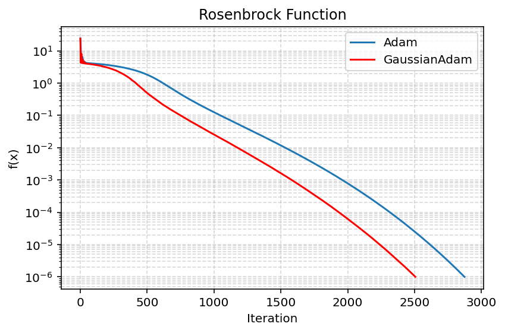
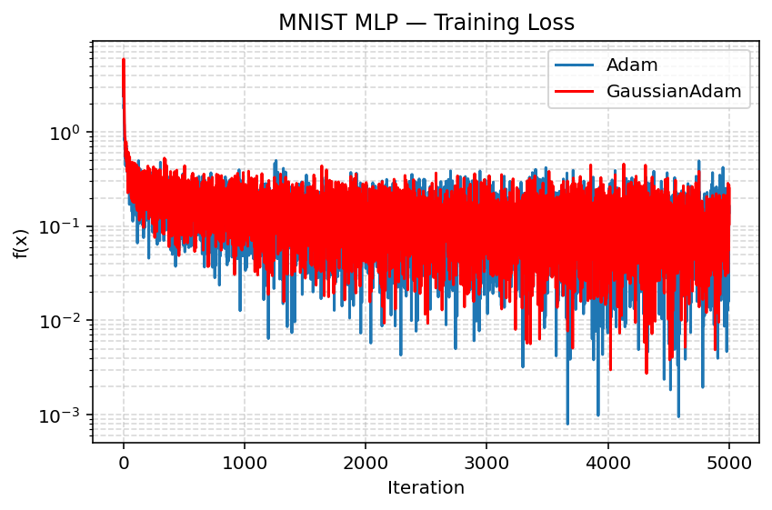
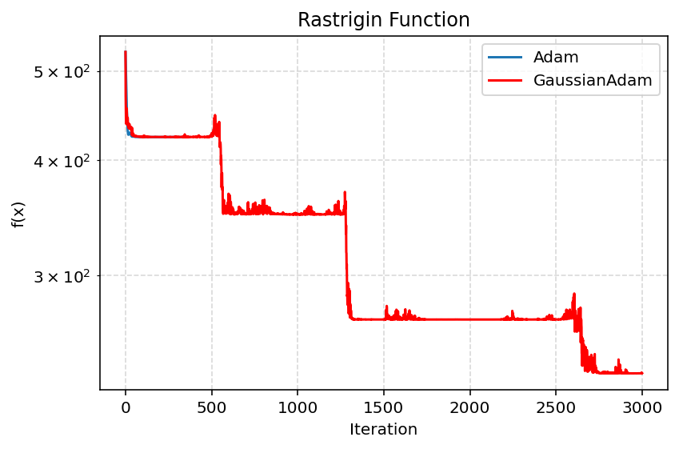

# GaussianAdam

**GaussianAdam** is an experimental variant of Adam that multiplies Adam's parameter update by a positive, randomly varying factor. The project asks whether this early exploration helps optimization escape poor local minima, and how much convergence speed or training accuracy it costs.

This repository contains the optimizer, a small NumPy benchmarking framework, saved plots and data, a hyperparameter search for Rastrigin, and the original LaTeX report. This README summarizes the report and its evidence so the main findings are available directly on GitHub.

## Method

Adam maintains exponential first and second gradient moments and applies bias correction:

$$
m_t=\beta_1m_{t-1}+(1-\beta_1)g_t,\qquad
v_t=\beta_2v_{t-1}+(1-\beta_2)g_t^2.
$$

GaussianAdam uses the same moments, then updates parameters with

$$
\theta_{t+1}=\theta_t-\alpha_0(1+\xi_t)
\frac{\hat m_t}{\sqrt{\hat v_t}+\epsilon},\qquad
\xi_t=|\mathcal N(0,\sigma_t^2)|,\qquad
\sigma_{t+1}=(1-\gamma)\sigma_t.
$$

The folded (absolute-value) Gaussian makes the multiplier nonnegative and at least one. The noise scale decays geometrically, so the update approaches Adam's update as the noise vanishes. `alpha` is the base learning rate, `gaussian_std` is the initial noise standard deviation, and `gamma` controls its decay. The implementation samples one noise value per parameter on each step.

## What the experiments show

The report compares against Adam and AdaGrad in its saved plots; other optimizers are implemented in the framework but are not enabled in the default driver. Results are benchmark-specific, and the stochastic optimizer's Rastrigin results depend strongly on tuning.

| Benchmark | Reported result |
| --- | --- |
| Well-conditioned quadratic (`κ = 10`) | Across 100 GaussianAdam runs: **157.71 ± 2.53 iterations**, mean runtime **0.00182 ± 0.00009 s**. The report's example comparison says GaussianAdam used fewer iterations than Adam, but was not the fastest optimizer overall. |
| Ill-conditioned quadratic (`κ = 200`) | Across 100 runs: **423.11 ± 10.54 iterations**, mean runtime **0.00484 ± 0.00017 s**. The report says GaussianAdam beat Adam and AdaGrad in iterations; AdaGrad remained faster in runtime. |
| Rosenbrock, start `(-1.2, 1.0)` | Across 100 runs: **2547.46 ± 95.84 iterations**, mean runtime **0.02799 ± 0.00196 s**. The saved example trace reaches the stopping region sooner than Adam (about 2,500 vs. 2,875 iterations). |
| MNIST, one-hidden-layer MLP | The report gives **95.53% mean test accuracy** over five GaussianAdam runs (±0.17 percentage points), versus **96.38% for Adam** in its comparison. It reports that GaussianAdam did not beat Adam on accuracy or runtime. |
| 10-dimensional Rastrigin | Default settings stall in local minima. A grid search reports best final loss **4.974795** at `alpha ≈ 0.3124`, `gamma ≈ 0.00673`, `gaussian_std = 10`. The global minimum is 0, so this is evidence of improved exploration over the shown default run, not a demonstrated global optimum. |

The report's quadratic and Rosenbrock averages are useful summaries, but the repository does not include the raw 100-run samples for those tables. Runtimes are machine- and environment-dependent. The MNIST plot is noisy and the saved comparison does not establish a controlled, repeated head-to-head result for both optimizers.

### Selected figures

**Rosenbrock:** the saved trace shows GaussianAdam descending faster than Adam for this run.



**MNIST:** training-loss traces are broadly comparable, with substantial mini-batch noise.



**Rastrigin:** this tuned example makes several large downward moves between local basins, but ends above the global minimum.



The Rastrigin parameter sweep is visualized in [the hyperparameter landscape](Report/rast_hyperparam_search.png). Its plotted best point corresponds to the reported loss of about 4.975.

## Project layout

- [`Benchmarking Framework/`](Benchmarking%20Framework/) — NumPy optimizer implementations, objective functions, plotting helpers, and MNIST MLP benchmark.
- [`Report/main.tex`](Report/main.tex) — full report source and its referenced figures.
- [`Report/`](Report/) — report plots, including iteration traces, runtimes, noise, and aggregate statistics.
- [`Data/`](Data/) — benchmark output figures and dataset-specific notes.
- [`Hyperparameter_Search/`](Hyperparameter_Search/) — Rastrigin search data, analysis script, and summarized best parameters.

## Run the benchmarks

The framework uses Python 3, NumPy, and Matplotlib. The MNIST benchmark additionally requires TensorFlow/Keras to download and load the dataset.

```bash
python -m pip install numpy matplotlib
# Optional, only for MNIST:
python -m pip install tensorflow

cd "Benchmarking Framework"
python main.py
```

As currently configured, `main.py` runs the Rosenbrock (`RsB`) and Rastrigin (`Rast`) examples and displays plots. To select other implemented benchmarks, edit the `run_all([...])` list at the bottom of `main.py` to include `wcQ`, `icQ`, or `MNIST`. The MNIST run is configured for 5,000 iterations and can take substantially longer. The Rastrigin parameter-search call is commented out; the large sweep can be enabled in that same entry point, or explored using the stored `Hyperparameter_Search/params.csv` and analysis script.

The benchmark wrapper stops when the gradient norm is below tolerance, the objective reaches its target (where configured), or the iteration limit is reached. Rastrigin uses a fixed initial point generated from seed 0, while the quadratic matrix and initial point are also seeded. GaussianAdam's noise uses NumPy's global random generator and is not seeded by the benchmark driver, so runs vary.

## Important implementation and report notes

- The report's stated standard GaussianAdam settings are `alpha = 0.02`, `gamma = 0.001`, and initial standard deviation `σ₀ = 1`. The current `myGaussianAdam` constructor instead defaults to `gaussian_std = 15` (with `gamma = 0.001`). Set `gaussian_std=1` explicitly to match the report's stated default. The report's tuned Rastrigin search selects different values.
- In the implementation, despite the `expected_noise` argument, every call samples fresh noise; the argument currently has no effect. The code decays the standard deviation after drawing noise for the current step.
- Saved report plots and tables document prior runs; running the current scripts does not necessarily regenerate identical figures or reported numbers. In particular, the report, saved artifacts, and current driver are not a fully automated reproducibility pipeline. Treat performance figures as experimental evidence for this implementation and setup, not as general convergence guarantees.

## License

See [`LICENSE`](LICENSE).
